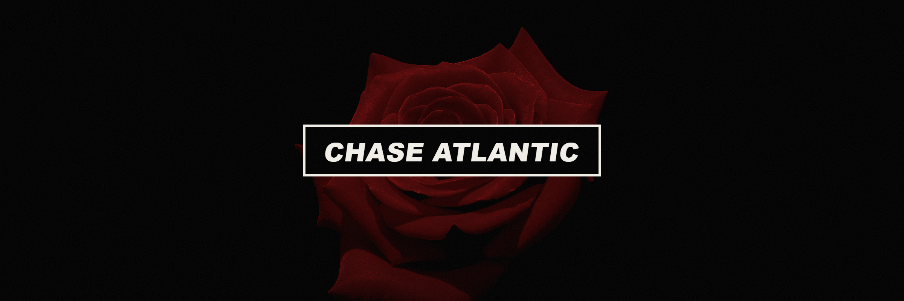
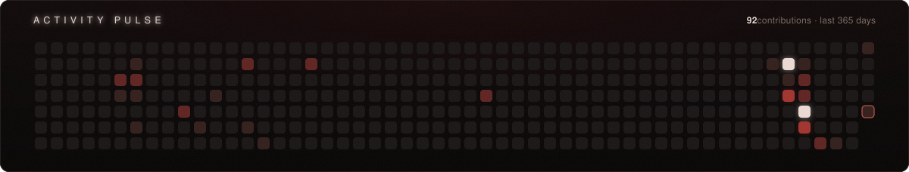

 
S O F T W A R E &nbsp; E N G I N E E R I N G &nbsp; S T U D E N T &nbsp;&nbsp;·&nbsp;&nbsp; B A C K E N D &nbsp; D E V E L O P E R &nbsp; I N &nbsp; P R O G R E S S

## 01 · About

I'm a **Software Engineering student** passionate about building real-world software and constantly improving my development skills. Currently, I'm focusing on **C#/.NET, SQL, Automation, backend development, and APIs**, while also exploring **Python** and web technologies. I enjoy turning ideas into practical projects and learning by actually building things.

🚀 **Currently working on:**

- 🏨 A WhatsApp Automation System with my team
- 🔹 C# & .NET backend development
- 🗄️ SQL & database design
- 🌐 REST APIs
- 🐍 Improving my Python skills

🎯 **Goal:** Become a strong backend/software engineer and build software that solves real problems.

## 02 · Activity Pulse

 every block is a real contribution · rebuilt daily from my contribution calendar

## 03 · Tech Stack

                         

## 04 · GitHub Signal

 

## 05 · Connect

 <em>"Learn. Build. Improve. Repeat."</em>

🔸 Banner rose photo: [Wikimedia Commons — *Red rose with black background* by Laitche](https://commons.wikimedia.org/wiki/File:Red_rose_with_black_background.jpg), CC BY-SA 4.0, duotone treatment. 
🔸 Activity pulse is generated by me — see [scripts/generate-pulse.mjs](scripts/generate-pulse.mjs).

